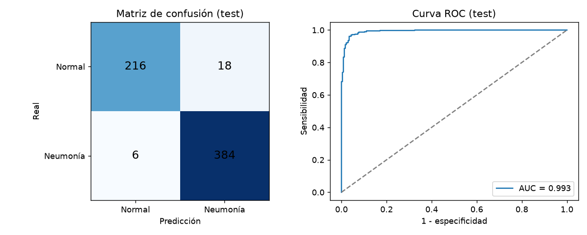
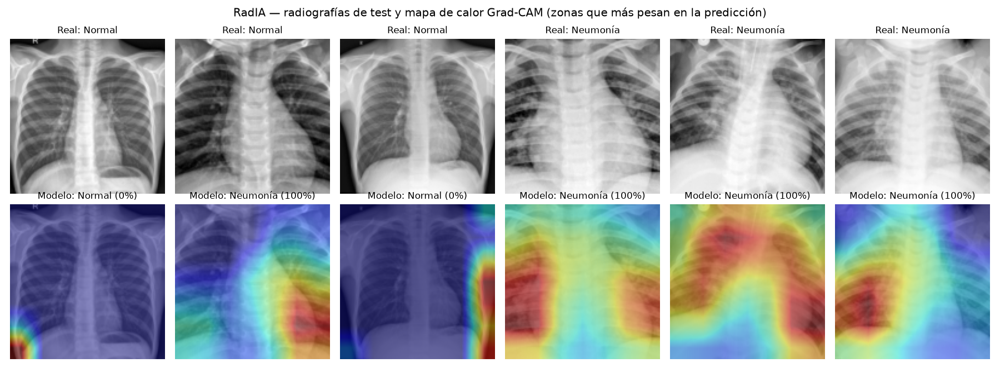

# RadIA — IA aplicada a salud

**Autor:** Gustavo Andrés Peña Blumenberg · Informático Biomédico (DUOC UC)
**Desarrollado con:** Claude Code (IA generativa) · Python · PyTorch · scikit-learn · Gradio

> ⚠️ **Proyecto educativo.** No es un dispositivo médico, no está validado clínicamente y no reemplaza la evaluación de un profesional de salud.

RadIA tiene dos módulos:

1. **Radiografías de tórax → neumonía.** Una red neuronal convolucional (ResNet-18 preentrenada en ImageNet y ajustada con *fine-tuning*) clasifica la radiografía como *normal* o *compatible con neumonía* y genera un **mapa de calor Grad-CAM** con las zonas que más pesan en la decisión.
2. **Síntomas → orientación diagnóstica.** Un clasificador de texto (TF-IDF + regresión logística) recibe la descripción de síntomas y devuelve los 3 diagnósticos más probables entre 22.

## Resultados (datos de prueba, nunca vistos en el entrenamiento)

### Radiografías — 624 imágenes de test (234 normales, 390 con neumonía)

| Métrica | Valor |
|---|---|
| Exactitud (accuracy) | **96,2 %** |
| Sensibilidad (neumonías detectadas) | **98,5 %** (384 de 390) |
| Especificidad (normales bien descartadas) | **92,3 %** (216 de 234) |
| Valor predictivo positivo | 95,5 % |
| AUC ROC | **0,993** |

El umbral de decisión (0,92) se eligió en el conjunto de **validación** (índice de Youden) y el test se midió una sola vez con ese umbral. Con el umbral por defecto de 0,5: exactitud 95,0 %, sensibilidad 99,5 %, especificidad 87,6 %.





*Fila superior: radiografía y diagnóstico real. Fila inferior: predicción del modelo y mapa de calor. La segunda imagen es un **falso positivo** (normal clasificada como neumonía): el mapa muestra que el modelo miró el borde del corazón, un ejemplo de por qué estos modelos necesitan supervisión clínica.*

### Síntomas — 212 descripciones de test, 22 diagnósticos

| Métrica | Valor |
|---|---|
| Exactitud | **94,8 %** |
| F1 macro | 94,8 % |

## Datos

- **PneumoniaMNIST** (MedMNIST v2, licencia CC BY 4.0): 5.856 radiografías pediátricas de tórax derivadas de Kermany et al. (2018). Usado a 128×128 px. División oficial: 4.708 entrenamiento / 524 validación / 624 test.
- **Symptom2Disease** (`gretelai/symptom_to_diagnosis` en Hugging Face): 1.065 descripciones de síntomas en inglés con 22 diagnósticos. División oficial: 853 entrenamiento / 212 test.

## Cómo ejecutarlo

```bash
python -m venv .venv
.venv\Scripts\activate
pip install torch torchvision --index-url https://download.pytorch.org/whl/cu128   # o la versión CPU
pip install -r requirements.txt
python src/train_symptoms.py          # ~10 s
python src/train_xray.py --epochs 12  # ~10 min en una GPU RTX 5060
python src/examples.py                # figura de Grad-CAM
python app.py                         # demo en http://127.0.0.1:7860
```

Los modelos entrenados ya vienen en `models/`, así que `python app.py` funciona sin reentrenar.

## Limitaciones (importante)

- Las radiografías son **pediátricas** y de un solo centro; el modelo no está probado en adultos ni en otros equipos.
- Distingue solo *normal* vs *neumonía*; no detecta otras patologías.
- El módulo de síntomas se entrenó con textos en **inglés**; la demo traduce términos comunes del español con un glosario simple, así que descripciones con otras palabras pueden fallar.
- Las métricas vienen de un conjunto de test público, no de un estudio clínico.

## Estructura

```
app.py                 demo Gradio (radiografía + síntomas)
src/train_xray.py      entrenamiento y evaluación del modelo de radiografías
src/gradcam.py         mapas de calor Grad-CAM
src/train_symptoms.py  modelo de síntomas
src/examples.py        figura de ejemplos
results/               métricas (JSON) y figuras
models/                modelos entrenados
```
